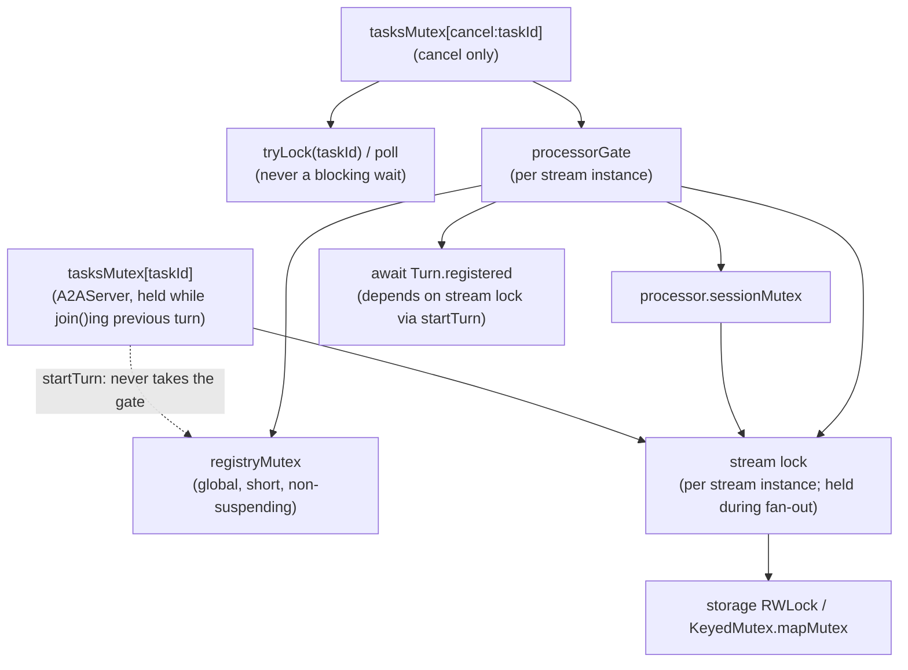

# How the a2a-server session layer works now: turns, SessionManager, TaskEventStream and locks

**Sources checked:**
- Koog `eugenethedev/a2a-1.0` @ `5364d68cb` (HEAD). The session files had no uncommitted changes when read. Pre-v1 baseline: `946cd5ff0~1` (= `1081e7482`). Range covered: `887b947e6..HEAD` (12 commits).
- A2A spec repo @ `v1.0.1` (spot-checked: `docs/specification.md` L208-211, L309-311, L446-448, L683-694; `specification/a2a.proto` L296-305). `main` @ `7c861a5`. All other spec, Python SDK and TCK citations are taken from `a2a/.agents/research/server-session-redesign-proposal.md` (marked "[proposal]") and were not re-verified here.
- Decisions: `a2a/.agents/state.md`.
- Shared lock primitives: `agents/agents-utils/src/commonMain/kotlin/ai/koog/agents/lock/{KeyedMutex,RWLock}.kt`.

All `path:line` citations below are relative to `a2a/a2a-server/src/commonMain/kotlin/ai/koog/a2a/server/` unless another prefix is given. `pre:` means the file as of `946cd5ff0~1`.

**Confidence:** high for the description of the code, the lock order, and the flows. The flaky-hang root cause was found by code analysis and has not been reproduced, so it is **medium**. The simplifications are design judgement.

---

## Overview

**Before v1**, one object did everything. A `Session` was one `AgentExecutor.execute` call, with its own hot `MutableSharedFlow`. When that call ended, the flow closed and the session was removed (`pre:session/SessionManager.kt:77-94`). Everything that streamed events was attached to that one execution, so:
- SubscribeToTask attached to it, and got an empty stream when no execution was running (`pre:A2AServer.kt:611`);
- Cancel on an idle task published into a processor that nobody listened to (`pre:A2AServer.kt:569-573`).

**A2A v1 needs two lifetimes at once:**
1. **Task-long streams.** SubscribeToTask works on *any non-terminal task*, including an idle input-required one. It starts with a `Task` snapshot, follows the task across later executions, and closes only at a terminal state (spec §3.1.6 L309-311; TCK STREAM-SUB-002, STREAM-ORDER-002..004 [proposal]). All streams of a task get the same events in the same order (spec §3.5.2 L683-694).
2. **Request-long responses.** Blocking SendMessage returns at the first terminal **or interrupted** state (spec §3.2.2 L446). SendStreamingMessage closes at end of execution or at a terminal state (decision D-2; Python behaviour; §11.7 [proposal]). v1's `TaskStatusUpdateEvent` has no `final` flag (proto L296-305), so the only "this execution is done" signal for a non-terminal state is `execute` returning.

**The design (Option A in the proposal, chosen by the user):**
- The pre-v1 `Session` is kept and renamed in concept to a **turn**: one `execute` call.
- A new internal per-task **`TaskEventStream`**, owned by `SessionManager`, sits underneath. It is the single place where a task's events are persisted and fanned out, under one per-task **stream lock**.
- Each turn reads the stream through a **turn view**: a subscriber that is also closed at the turn's end.
- SubscribeToTask streams are **task subscribers**, closed only at a terminal state.
- Cancellation publishes through the same stream (`withTaskProcessor`), so every stream sees it.

On top of that, later commits added:
- back-pressure instead of eviction (user decision D-5 revised, `b6dc6eab7`);
- a split of the global registry lock from the per-task stream lock (`c2f9845d8`);
- v1 send semantics (`897095aa9`);
- server-side history persistence (`43ef39c7c`, `5364d68cb`);
- server-forced CANCELED (`f57327f6b`).

**What to watch.**
- The flaky hang in `testCancelRacingWithFollowUpTurnEndsInOneConsistentTerminalState` is most plausibly **not** a bug in the new session locks. It is a **cancellation-unsafe unlock in the shared `RWLock`** used by `InMemoryTaskStorage`. When the forced cancel cancels an agent that is in the middle of a storage read, the storage's write lock can leak forever (§5.1).
- The same unsafe-unlock pattern exists in `KeyedMutex.unlock` (the `tasksMutex`). In production it can lock a task forever when a client disconnects.
- The cancel polling loop and the two-step `startTurn` are workarounds. They exist because turn serialization (`tasksMutex`) lives in `A2AServer` while turn state lives in `SessionManager`. Both could be removed (§6).

---

## Requirements and decisions that drive the design

| # | Requirement / decision | Tier | Bindings (Koog: JSON-RPC) | Source | Forces |
|---|---|---|---|---|---|
| R1 | SubscribeToTask usable on any non-terminal task; terminates at terminal state | MUST, capability:streaming | all | spec §3.1.6 L309 | Stream outlives a turn → `TaskEventStream` |
| R2 | SubscribeToTask first event = Task at subscription time | MUST, capability:streaming | all | spec §3.1.6 L311 | Atomic snapshot+register under stream lock |
| R3 | Events broadcast to all streams, same order; closing one doesn't affect others | MUST | all | spec §3.5.2 L683-694 | Persist+fan-out under one per-task lock |
| R4 | Blocking SendMessage waits until terminal **or interrupted** | MUST | all | spec §3.2.2 L446; D-1 | Turn view consumed until stop state; agent may keep running |
| R5 | `returnImmediately` returns after task creation | MUST | all | spec §3.2.2 L448 | Same |
| R6 | Task stream begins with Task; message stream = exactly one Message | MUST, capability:streaming | all | spec §3.1.2 L208-210; D-4 | `taskSnapshot` for follow-up streams |
| R7 | SendStreamingMessage closes at end of turn or terminal (not only terminal) | design decision D-2 (spec inconsistent) | all | state.md D-2; proposal Discrepancy 2 | Turn-end marker = turn-view close |
| R8 | Server persists user messages into history (dedup by id), lazily before the first non-Task agent event | MAY (spec §3.7); user decision (D-3, "literal D-3" after M8c) | all | state.md | `pendingFollowUpMessage`, `persistUserMessage` |
| R9 | Executor crash → FAILED for everybody, generic message | design decision (Python) | all | state.md M8a follow-ups | `endTurn(failure)` / `markFailed` |
| R10 | Cancel: unknown → TaskNotFound; terminal → TaskNotCancelable; otherwise ends CANCELED even if executor does nothing; events reach every stream | MUST (errors) + user decision 3.10 | all | state.md "3.10" | `withTaskProcessor`, gate, `sendServerTaskEvent`, polling |
| R11 | No eviction; back-pressure | user decision D-5 (revised) | all | state.md D-5 | Rendezvous channels, fan-out under stream lock |
| R12 | A stalled task must not block other tasks | bug fix approved by user (M8a3) | — | `c2f9845d8` | Registry lock never held while waiting on a stream lock → 2-step `startTurn` |
| R13 | Idle tasks hold no memory | design (R-a in proposal) | — | proposal "R-a" | Ref-counted lazy streams |
| R14 | Turns of a task serialized (follow-up waits for running turn) | pre-existing Koog behaviour | — | `pre:A2AServer.kt:393-395` | `tasksMutex` + `getSession()?.join()` |

R1–R7 apply to Koog's JSON-RPC binding. R1, R2, R6 and R7 apply only when `capabilities.streaming = true`; Koog checks this in `checkStreamingSupport` (`A2AServer.kt:898-902`).

---

## 1. What is a "turn", and why is it needed?

**Definition.** A turn is **one `AgentExecutor.execute` call** for one task id, started by `SessionManager.startTurn` and represented by a `Session` (`session/SessionManager.kt:36-43`, `session/Session.kt:9-15`). It begins when the agent job is started and ends when `execute` returns or throws, which is the only end-of-turn signal (`agent/AgentExecutor.kt:12-15`).

**Why the design needs it.**
- v1 has two kinds of client-visible streams with different lifetimes (R1 vs. R4/R7), and the server has to know where one execution's events stop.
  - With no `final` flag in v1 (`specification/a2a.proto@v1.0.1:296-305`), an `INPUT_REQUIRED` update by itself doesn't say "this request is answered". The agent might send more.
  - "`execute` returned" is the only reliable boundary. Python does the same with `_RequestStarted`/`_RequestCompleted` markers [proposal §1].
- Concrete forcing tests and decisions:
  - **STREAM-SUB-002** [proposal §2] needs a SubscribeToTask stream that survives an input-required turn and receives the *next* turn's events. So the stream cannot be the turn.
  - **D-2** (send-streams close at end of turn) and **D-1** (blocking returns at interrupted *or end of turn*) need a per-turn boundary inside that task-long stream.
  - **R14**: follow-ups queue behind the running turn. That only makes sense if "the running turn" is a defined thing.

**What pre-v1 had.** The same concept under the name "session": `Session` + `LazySession` wrapped one `execute` call (`pre:session/Session.kt:18-88`). The difference is that pre-v1 had **only** the turn, with no task-long stream under it:
- `SessionEventProcessor` owned the `MutableSharedFlow` (`pre:session/SessionEventProcessor.kt:84-93`).
- Resubscribe attached to the running session's flow (`pre:A2AServer.kt:605-614`).

So "turn" is not a new concept. What is new is splitting the turn (request-scoped) from the task stream (task-scoped).

---

## 2. Entities

### 2.1 `Session` (public) — the turn handle
- **What:** `taskId`, `contextId`, `agentJob: Deferred<Unit>` (lazy), `events: Flow<Event>` (the turn view, single-collection), `join()`, plus internal `eventProcessor`, `completion: CompletableJob`, `taskSnapshot: Deferred<Task?>` (`session/Session.kt:23-58`).
- **Why:**
  - `events` is what `onSendMessageCommon` streams back to the requester (`A2AServer.kt:498-519`).
  - `join()` is what a follow-up waits on to serialize turns (R14, `A2AServer.kt:443`).
  - `taskSnapshot` gives a follow-up stream its leading `Task` (R6/D-4, `A2AServer.kt:492, 509-511, 534-536`).
- **Pre-v1:** the same class, but `events` was the processor's shared flow, and `join()` collected that flow and then joined the agent (`pre:session/Session.kt:49-52`). `start()`, `cancelAndJoin()` and the public constructor are gone. `LazySession` is gone.
- **Why `completion` instead of `agentJob.join()`:**
  - `join()` must mean "the turn is fully torn down": processor closed, view closed, removed from the registry (`session/SessionManager.kt:290-300`).
  - Otherwise a follow-up could call `startTurn` while the old turn is still registered and hit `check(taskId !in turns)` (`session/SessionManager.kt:192-194`).
- **Simpler alternative?** Not really. It is the minimum public handle.
  - `taskSnapshot` and the lazy `events = flow { emitAll(turnView.await()) }` (`session/SessionManager.kt:213`) exist only because the `Session` is built *before* its view is registered (the two-step `startTurn`, §2.7). With view-first registration both could be plain values.

### 2.2 `SessionManager` registry (`streams`, `turns`, `nextTurnId`, `registryMutex`)
- **What:** a global map `taskId → StreamEntry(stream, holders)` and a map `taskId → Turn(session, registered)`, plus a turn-id counter, all guarded by `registryMutex` (`session/SessionManager.kt:110-141`).
- **Why:**
  - `turns` answers "is a turn running for this task?" for `getSession`/`join` (R14) and for cancellation (`withTaskProcessor`).
  - `streams` makes sure every party working on a task at the same moment shares **one** `TaskEventStream` instance. The stream lock and gate are per instance, so this sharing is what makes them mutually exclusive.
- **Pre-v1:** `sessions: Map<String, Session>` + `RWLock sessionsRwLock` (`pre:session/SessionManager.kt:51-52`). The RWLock became a plain `Mutex`; reads are tiny, so this costs nothing.
- **Simpler alternative?** The registry itself is essential. The `holders` refcount is essential for R13; the alternative is keeping a stream per task until it is terminal, which leaks memory for abandoned input-required tasks. A per-task (striped) registry would also have avoided R12, but the current "never wait on anything while holding it" rule is simpler.

### 2.3 `StreamEntry.holders` (refcount)
- **What:** the number of turns, `withTaskProcessor` blocks and subscribers currently using the stream. `acquire`/`acquireLocked` increment it and `release` decrements it. The stream is dropped at 0 (`session/SessionManager.kt:110-115, 441-466`).
- **Why:** lazy create/drop (R13). The `TaskEventStream` holds no task state (it reads storage, `session/TaskEventStream.kt:31-34`), so it can be recreated at any time.
- **Invariant it relies on:** every party that publishes through a stream holds a count while doing so. Otherwise a second instance could be created for the same task, and that instance would have *its own* stream lock and gate, which breaks R3. See §5.6 for the one way this invariant can be broken (a leaked standalone processor).
- **Pre-v1:** none. The session was the only per-task object.

### 2.4 `TaskEventStream` (internal) — the per-task stream
- **What** (`session/TaskEventStream.kt:76-356`):
  - `mutex`, the **stream lock** (`:99`);
  - `subscribers: List<Subscriber(channel, turnId?)>` (`:87-101`);
  - `processorGate` (`:108`);
  - operations: `subscribe(lookup)` (snapshot + register, with TaskNotFound/Unsupported checks, `:118-128`); `openTurnView(turnId[, historyLength])` (`:133-149`); `publish` (`:180-217`); `endTurn` (`:254-262`); `closeTurnView` (`:267-269`); `unsubscribe` (lock-free `channel.cancel()`, `:156-158`).
- **Why:**
  - R1: it outlives turns.
  - R2: `subscribe` reads the snapshot and registers under the same lock that guards persist + fan-out, so no gap and no duplicate.
  - R3: one lock orders storage writes and deliveries for *all* publishers of a task (turn processor and cancel processor).
  - R8: history merge happens here (`persistUserMessage`, `:231-241`; new-task `plusIfAbsent`, `:196-200`). "Ignore Task for existing task" is also here (`:187-194`, user decision).
  - R9: `markFailed` (`:271-296`).
- **Pre-v1:** none. The nearest equivalent was `SessionEventProcessor._events` (a `MutableSharedFlow()`, `pre:session/SessionEventProcessor.kt:84`) plus `taskStorage.update` under the processor's `sessionMutex` (`pre:…:128-152`). That only ordered events of *one processor*. A cancel processor and the turn processor were not ordered against each other, and late subscribers had no snapshot.
- **Simpler alternative?** No, not while R1–R3 hold. This is the core of the redesign.

### 2.5 Subscribers: turn views vs. task subscribers
- **What:** both are entries in `subscribers`, each with a rendezvous `Channel<Event>` (`session/TaskEventStream.kt:305-312`).

  | | Task subscriber (SubscribeToTask) | Turn view (requester of a turn) |
  |---|---|---|
  | `turnId` | `null` | the turn's id |
  | Receives | every `TaskEvent` | every `TaskEvent` + its own turn's `Message` (`:213`) |
  | Closed at | terminal state (`closeAll`, `:223-225, 346-349`) | terminal state, or `endTurn`/`closeTurnView` for its turn (`:298-302`) |

- **Why:** R1 vs. R4/R7. Closing the view channel **under the stream lock** after the turn's last fan-out is the in-band end-of-turn marker (`:68-70`). The requester can't miss a final event or see an event of the next turn.
- **Why rendezvous channels:** D-5 (revised): no buffer, no eviction, so nothing is ever dropped (`b6dc6eab7`).
- **Pre-v1:** the `MutableSharedFlow()` subscribers with a `Close` sentinel (`pre:session/SessionEventProcessor.kt:78-93`), which was also back-pressured (no buffer).
- **Simpler alternative?** It is already minimal.

### 2.6 Turn ids (`nextTurnId`, `Subscriber.turnId`, processor `turnId`)
- **What:** a monotonically increasing `Long` assigned under `registryMutex` (`session/SessionManager.kt:197`). It is passed to the processor and to `openTurnView`/`endTurn`.
- **Why:**
  - Route a `Message` only to its own turn's view (`session/TaskEventStream.kt:213`).
  - Let `endTurn`/`closeTurnView` close only that turn's view (`:298-302`).
  - A cancel's standalone processor has `turnId = null`, so a `Message` from it goes nowhere.
- **Pre-v1:** not needed, because there was one flow per turn.
- **Simpler alternative:** keep a reference to the turn's `Subscriber` instead of an id. That is equivalent, not simpler.

### 2.7 `Turn.registered` and the two-step `startTurn`
- **What:**
  1. Under `registryMutex`: check, pin the stream, assign the turn id, build the processor and the `Session` with a **lazy** agent job, and put `turns[taskId]` (`session/SessionManager.kt:191-222`).
  2. Then, **outside** the registry lock: `openTurnView` under the stream lock, and complete `taskSnapshot`, `turnView` and `registered(true)` (`:225-234`).
  3. On failure or caller cancellation, undo everything under `NonCancellable` (`:235-251`).
  4. Only then launch `monitorTurn`, which starts the agent (`:253-255`).
- **Why:**
  - Commit `c2f9845d8` (R12). Before it, the view was registered under the stream lock *while holding the global registry lock*.
  - With back-pressure, a stream lock can be held for as long as the slowest reader needs. So one stalled task blocked `startTurn`, `subscribe`, `release` and `getSession` for **every** task.
  - `registered` lets `withTaskProcessor` wait for a turn that is visible but whose view isn't registered yet (`findRegisteredSession`, `:432-439`). Otherwise a cancel's CANCELED event could miss the requester's view.
- **Pre-v1:** `addSession` returned `monitoringStarted` and the caller started the agent after it (`pre:session/SessionManager.kt:64-117`, `pre:A2AServer.kt:454-463`). This was the same "register listener before agent starts" problem, solved with a different handshake.
- **Simpler alternative:** register the view **first** (pin the stream under the registry lock, release it, `openTurnView` under the stream lock), then insert into `turns`. See §6.

### 2.8 `SessionEventProcessor` (public; agent-facing)
- **What:** validates and forwards agent events to `stream.publish` (`session/SessionEventProcessor.kt:51-218`). Its state:
  - `sessionMutex`, which serializes the processor's own sends (pre-existing);
  - `_isOpen` (closed after a Message, after a terminal event, or at turn end);
  - `isTaskEventSent` (gates Message-vs-task mode; also used to decide on push);
  - **task mode** `taskExists` (`:56, 120-122`): a follow-up's agent may send only task events (fixes proposal gap G9; `897095aa9`);
  - **`pendingFollowUpMessage`** (`:81, 187-197`): the follow-up's user message, persisted by the stream right before the first applied non-Task `TaskEvent` (literal D-3, `5364d68cb`);
  - `storedUserMessage` (`:76`): the user message with the task's ids filled in (user decision);
  - `rejection` (`:86, 207-210`): the first rejected agent event, so the server can answer -32006 even if the agent swallowed the exception (user decision; `A2AServer.kt:529-532`).
- **Pre-v1:** owned the flow and wrote to storage itself (`pre:…:84-160`). It is now a thin validator; `events`/`close`/`isOpen` are no longer public.
- **Simpler alternative?** Not without changing the agent-facing API, which the proposal deliberately kept.

### 2.9 `sendServerTaskEvent` (internal)
- **What:** like `sendTaskEvent`, but `persistFollowUpMessage = false` (`session/SessionEventProcessor.kt:165-176`). It is used only for the server-forced CANCELED (`A2AServer.kt:800-809`).
- **Why:** with lazy history persistence (R8), the turn processor's *first* non-Task event triggers `persistUserMessage`. A forced CANCELED on a follow-up turn that the agent never acted on must not count as "the agent's first event", or the user message would be persisted only because the server cancelled.
- **Pre-v1:** none.
- **Note:** `AgentExecutor.cancel` implementations that call `sendTaskEvent` on the *turn's* processor still trigger the persistence. That is arguably correct, because it is agent-originated.

### 2.10 `processorGate` ("turn-end gate")
- **What:** a per-stream `Mutex` (`session/TaskEventStream.kt:103-108`), held:
  - by `withTaskProcessor` around the whole cancel block, including user code `AgentExecutor.cancel` (`session/SessionManager.kt:389-400`);
  - by `monitorTurn` around "close processor → `endTurn` → remove from registry" (`:281-285`).
- **Why:** R10 + "cancel events reach the turn's requester". While a cancel handler is cancelling and joining the agent and then sending CANCELED through the *turn's* processor, the turn must not be torn down (processor closed, view closed). Otherwise the requester's stream ends without the CANCELED event.
- **Pre-v1:** this is the **direct replacement** for the old teardown use of the cancel lock. Pre-v1's monitor took `tasksMutex.withLock(cancelKey(taskId))` before removing the session and closing the processor (`pre:session/SessionManager.kt:85-94`). `SessionManager` no longer receives `tasksMutex`/`cancelKey`.
- **Simpler alternative:**
  - A refcount of "processor users" that `monitorTurn` waits for is equivalent.
  - Always using a standalone processor for cancel doesn't remove the need, because the requester's view would close at turn end, before CANCELED.
  - The gate is essential as long as "the streaming requester of a cancelled turn sees CANCELED" is required. That holds pre-v1, is tested by `testCancelRunningTaskEndsRequesterWithCanceledTaskWhenExecutorCancels` and `testWithTaskProcessorKeepsRunningTurnOpen`, and matches spec R3.

### 2.11 `withTaskProcessor` (public)
- **What:** acquire the stream → gate → `findRegisteredSession` → the turn's processor + agent job, or a new standalone processor (`turnId = null`) + `null` → run the block (`session/SessionManager.kt:381-404`).
- **Why:** R10. Cancel must publish through the task stream even when idle (proposal gap G10).
- **Pre-v1:** inline in `onCancelTask` (`pre:A2AServer.kt:559-587`), with a standalone processor that nobody listened to.

### 2.12 `monitorTurn`
- **What:** start and await the agent → log non-cancellation failures → gate { close processor; `endTurn(turnId, failure)`; remove turn } → finally (NonCancellable) { `closeTurnView`; remove turn if still there; release stream } → `completion.complete()` → push if `isTaskEventSent` (`session/SessionManager.kt:263-305`).
- **Why:** R9 (FAILED is written *inside* the turn, before the view closes, so the requester and all subscribers see it); R7 (end-of-turn marker); R13 (release).
- **Pre-v1:** the monitor coroutine (`pre:session/SessionManager.kt:77-114`).
- **Push:** still pre-v1-style (one raw `Task` after each turn; `:302-324`). This is pending M8e.

### 2.13 `A2AServer.tasksMutex` (`KeyedMutex<String>`) and `cancelKey`
- **What:** per-task-id lock (`A2AServer.kt:354-365`). `onSendMessageCommon` holds it across "join the previous turn → validate → `startTurn`" (`:441-490`). `cancelKey(taskId)` is a second key that serializes cancels (`:722`).
- **Why:**
  - R14: turn serialization. It also makes the validation (task exists, not terminal, contextId) atomic with starting the turn (3.2/3.3).
  - The `cancelKey` lock prevents two concurrent cancels on one task.
- **Pre-v1:** the same lock, the same use. `cancelKey` was *also* used by session teardown; that role moved to the gate.

---

## 3. Locks and gates: what each protects, and what breaks without it

### 3.1 Inventory

| Lock | Scope | Protects | Held across suspension? | Pre-v1 equivalent | Without it (concrete interleaving) |
|---|---|---|---|---|---|
| `A2AServer.tasksMutex[taskId]` (`A2AServer.kt:360`) | per task id (KeyedMutex, global `mapMutex` inside) | Turn serialization; validation-then-start atomicity | **Yes**: waits for `Session.join()` of the previous turn | same | Two follow-ups both see INPUT_REQUIRED, both call `startTurn` → the second hits `IllegalStateException` (`session/SessionManager.kt:192`). Or a follow-up validates "non-terminal", then a cancel completes, then the turn starts on a CANCELED task |
| `tasksMutex[cancelKey(taskId)]` (`A2AServer.kt:722`) | per task | Serializes CancelTask calls | Yes | same key; teardown role moved to gate | Two cancels both see non-terminal, both force CANCELED → duplicate CANCELED fanned out |
| Cancel `tryLock(taskId)` + 5 ms poll (`A2AServer.kt:712, 725-738`) | per task | "Don't force CANCELED on an idle task while a follow-up that already validated is about to start a turn" | the poll `delay` | pre-v1 had a `tryLock` only ("cancellation takes priority") | See §3.3 |
| `registryMutex` (`session/SessionManager.kt:134`) | **global** | `streams`, `holders`, `turns`, `nextTurnId` | **Never** (only non-suspending bookkeeping, R12) | `sessionsRwLock` (RWLock) | Concurrent `getOrPut`/refcount races → two `TaskEventStream` instances for one task → two stream locks → R3 violated |
| `TaskEventStream.processorGate` (`session/TaskEventStream.kt:108`) | per stream instance | Turn teardown vs. a `withTaskProcessor` block using the turn's processor | Yes (user `cancel` code, `cancelAndJoin`) | `cancelKey` lock in teardown (`pre:session/SessionManager.kt:89`) | Cancel handler: `agentJob.cancelAndJoin()` → `monitorTurn` sees the agent done → closes the processor + view → the handler's `sendTaskEvent(CANCELED)` → `SessionNotActiveException`; the streaming requester ends without CANCELED |
| `TaskEventStream.mutex` (stream lock) (`:99`) | per stream instance | Storage write + fan-out + subscriber set | **Yes**: fan-out waits for the slowest reader (R11) | the processor's `sessionMutex` + `MutableSharedFlow.emit` (per processor only) | (a) A subscriber reads the snapshot at state S, then an event E is persisted and fanned out before the subscriber registers → E lost (R2). (b) A cancel processor and the turn processor fan out concurrently → subscribers see different orders (R3) |
| `SessionEventProcessor.sessionMutex` (`session/SessionEventProcessor.kt:106`) | per processor | Validation state (`_isOpen`, `isTaskEventSent`, `pendingFollowUpMessage`) | Yes (through `publish`) | same | Two concurrent `sendTaskEvent` calls both see the pending user message → persisted twice (it is deduped, but `pendingFollowUpMessage` races) |
| `Turn.registered` (`session/SessionManager.kt:120-126`) | per turn | "Turn view exists before anyone publishes through this turn's processor from outside" | n/a (a deferred) | `monitoringStarted` job (`pre:…:73-79`) | Cancel finds a turn that is visible but whose view isn't registered, publishes CANCELED → the requester's view registers afterwards and never sees it |
| Storage `RWLock` (`InMemoryTaskStorage`, `agents/agents-utils/.../RWLock.kt`) | per storage | Task map | Yes | same | — (see §5.1: **cancellation-unsafe**) |

### 3.2 Lock order

The documented order is `session/SessionManager.kt:55-60`. Reconstructed from the code:



Rules, in words:
1. **`tasksMutex[taskId]` → (registry, short) → stream lock.** `startTurn` runs under the task lock and takes the stream lock in `openTurnView`. It never takes the gate.
2. **`cancelKey` → gate → {registry (short), `await registered`, processor `sessionMutex` → stream lock}.** Cancel **never blocks on `tasksMutex[taskId]` while holding the gate**; it only `tryLock`s (`A2AServer.kt:729-737`).
3. **The registry lock is a leaf.** Nothing is acquired while holding it. It is taken *inside* the gate (`session/SessionManager.kt:284`), which is safe because the registry is never held while waiting on anything else.
4. **The stream lock and the registry lock are never nested** in either direction (`c2f9845d8`).
5. **Gate → stream lock, never stream lock → gate.** `monitorTurn` takes the gate, then `endTurn` takes the stream lock (`session/SessionManager.kt:281-283`).

Two "waits" are not locks but act like edges:
- `Session.join()` under `tasksMutex[taskId]` waits for `monitorTurn`, which needs the gate. That gives the edge "task lock → gate". This is why cancel may not wait for the task lock while holding the gate.
- `await Turn.registered` under the gate waits for `startTurn`'s stream-lock acquisition. That gives the edge "gate → stream lock", which is consistent with rule 5.

### 3.3 Why the cancel uses `tryLock` + 5 ms polling

Three constraints apply at once:
- **(a) Cancel must not wait for the task lock outright.** A queued follow-up holds `tasksMutex[taskId]` while it `join()`s the *running* turn. If cancel waited for that lock, it would wait for the running turn to finish, and that turn may be exactly the one being cancelled (an agent running forever). That is a deadlock. Pre-v1 already used `tryLock` for this reason (`pre:A2AServer.kt:543-548`).
- **(b) Cancel must not wait for the task lock inside the gate.** The holder can be `join()`ing a turn whose `monitorTurn` needs the gate. That gives the cycle gate → task lock → `join` → gate (`A2AServer.kt:729-735`, comment).
- **(c) Cancel must not force CANCELED on an idle task while another request holds the task lock.** That holder may already have validated "non-terminal" and will start a turn right after. Its agent's events would then be persisted on top of CANCELED, because nothing in the stream rejects events for a terminal task.

So `cancelWithProcessor` proceeds only if a turn is running (cancel *that* turn), or if cancel itself holds the task lock (`A2AServer.kt:766`). Otherwise it returns `null`, and the loop retries `tryLock` every 5 ms (`:725-738`) until either the lock is free or the follow-up's turn appears.

---

## 4. Main flows, with the locks held at each step

Notation: `[TL]` = `tasksMutex[taskId]`, `[CK]` = cancel key, `[G]` = gate, `[R]` = registry (short), `[S]` = stream lock, `[PM]` = processor mutex, `[RW]` = storage lock.

### 4.1 New task, blocking SendMessage (`A2AServer.kt:578-614` → `426-538`)
1. Validate parts and `historyLength`. Generate a `taskId` (`:433-439`).
2. `[TL]` `getSession(taskId)` `[R]` → `null` (`:441-443`). No referenced task. Compute `contextId` (`:466-468`).
3. `startTurn` (`session/SessionManager.kt:173-258`):
   - `[R]`: check; `acquireLocked` (create stream, `holders = 1`); `turnId`; processor(`taskExists = false`, `userMessage`); `Session`(lazy agent); `turns[taskId] = Turn`.
   - `[S]` `openTurnView(turnId)` → rendezvous channel.
   - Complete `taskSnapshot(null)`, `turnView`, `registered(true)`.
   - Launch `monitorTurn`, which starts the agent.
4. Release `[TL]`. Collect `session.events` (`:498-519`).
5. Agent: `sendTaskEvent(Task)` → `[PM]` → `[S]` `publish`: `get` `[RW]` (absent) → append the user message (`session/TaskEventStream.kt:196-200`) → `update` `[RW]` → fan-out (suspends until the requester takes it) → `closeAll` if terminal.
6. `onSendMessage`'s `firstOrNull` stops at the first terminal/interrupted event (or the first `TaskEvent` with `returnImmediately`, `A2AServer.kt:587-596`). The abort cancels the view channel (`consumeAsFlow`). The response is read from storage with `historyLength` + all artifacts (`:607-613`). **The agent keeps running.** Its later fan-outs to the cancelled view return `false` and the view is dropped (`session/TaskEventStream.kt:321-324`).
7. Turn end (`monitorTurn`):
   - `[G]` { `close()` `[PM]`; `endTurn` `[S]` (FAILED if crashed, then close view); `[R]` remove turn }.
   - finally { `closeTurnView` `[S]`; `[R]` remove; `release` `[R]` (`holders = 0` → drop stream) }.
   - `completion.complete()`. Push (no locks).

### 4.2 New task, SendStreamingMessage (`A2AServer.kt:627-633`)
The same steps, but every event is emitted. The flow ends at a Message, at a terminal event, or when the view closes at turn end (D-2). If the turn produced nothing and an event was rejected, the requester gets `A2AInvalidAgentResponseException` (-32006) (`:525-532`). If the agent failed before creating the task, its exception is rethrown (`:527`, `awaitAgent`).

### 4.3 Follow-up SendMessage (blocking or streaming)
1. `[TL]` (may wait while a running turn of the task `join()`s, `:443`; **the task lock is held during this wait**).
2. Owner-scoped lookup `get(GetTaskRequest, ctx)` `[RW]`:
   - missing → `TaskNotFound`;
   - `contextId` mismatch → `InvalidParams`;
   - terminal → `UnsupportedOperation` (`:446-464`).
3. `startTurn` with `task != null`: processor in **task mode** with `pendingFollowUpMessage`. `[S]` `openTurnView(turnId, historyLength)` reads the snapshot and registers atomically (`session/TaskEventStream.kt:144-149`). Release `[TL]`.
4. The agent job first re-reads the full task (`A2AServer.kt:484-486`) into `RequestContext.task`. This read is separate from the snapshot (§5.7).
5. The agent's first applied non-Task `TaskEvent`: `[PM]` → `[S]`: `persistUserMessage` (`get` + `update`: move `status.message` into history, append the user message, clear the status message; dedup), then persist and fan out the event (`session/TaskEventStream.kt:205-211, 231-241`). An agent `Task` event is ignored (`:187-194`). An agent `Message` is rejected in task mode (`session/SessionEventProcessor.kt:120-122`).
6. Streaming: emit `taskSnapshot` before the first event (D-4), or the snapshot only if the turn produced nothing (`A2AServer.kt:506-512, 534-536`).

### 4.4 SubscribeToTask (`A2AServer.kt:831-838` → `session/SessionManager.kt:342-363`)
1. `checkStreamingSupport`.
2. `acquire` `[R]`.
3. `[S]` `subscribe { get(GetTaskRequest, ctx) }`: missing → `TaskNotFound`, terminal → `UnsupportedOperation` (thrown before the first emit, so the transport turns it into a plain JSON-RPC error); register the channel.
4. Emit the snapshot, then forward the channel until `closeAll` (terminal).
5. finally: `unsubscribe` (lock-free `cancel()`), then `release` `[R]`.

Note: when the snapshot is taken while a turn is running, the subscriber never receives that turn's `Message` (Messages go only to the turn view). That is correct.

### 4.5 CancelTask on an idle task (no turn running)
1. Owner-scoped lookup → `TaskNotFound` (`A2AServer.kt:704-705`).
2. `tryLock(TL)` → usually succeeds.
3. `[CK]` → `withTaskProcessor`: `acquire` `[R]` → `[G]` → `findRegisteredSession` `[R]` → `null` → standalone processor (`turnId = null`).
4. The block: `hasTaskLock` → re-read (terminal → `TaskNotCancelable`) → `AgentExecutor.cancel(ctx, processor, null)` → if still non-terminal: `sendServerTaskEvent(CANCELED)` `[PM]` → `[S]` (persist, fan out to subscribers, `closeAll`) → final read; not CANCELED → `TaskNotCancelable` (`:765-821`).
5. Release `[G]`, `release` `[R]`, `[CK]`, `[TL]`.

If `tryLock` fails, a follow-up holds `[TL]`, so the cancel loops: `withTaskProcessor` returns `null` → `tryLock` → `delay(5)` → … until it gets `[TL]` (the follow-up failed validation or finished) or the follow-up's turn appears (then 4.6 applies).

### 4.6 CancelTask on a running turn
1. `tryLock(TL)`. It fails only if a *queued* follow-up holds it; the turn's own starter released it after `startTurn`.
2. `[CK]` → `[G]` → `findRegisteredSession` → turn T (awaits `T.registered`, possibly behind a back-pressured `[S]`).
3. The block runs with T's processor and agent job:
   - `AgentExecutor.cancel(...)` (user code, holding `[G]`; may `cancelAndJoin` and `sendTaskEvent(CANCELED)` through T's processor; the requester's view is still open because T's `monitorTurn` is blocked on `[G]`);
   - if still non-terminal: `agentJob.cancelAndJoin()`, re-read, `sendServerTaskEvent(CANCELED)`.
4. Release `[G]`. T's `monitorTurn` runs: `close()`, `endTurn(failure = CancellationException)` (no FAILED), remove, release.
5. The requester of T: a blocking call sees CANCELED (terminal) and returns the stored task. A cancelled agent job is not reported as an error (`A2AServer.kt:552-556`).

### 4.7 Turn end and executor crash
- **Normal end:** 4.1 step 7.
- **Crash (non-cancellation exception):**
  - `monitorTurn` logs it, then under `[G]` → `[S]` `markFailed`: if the task exists and is non-terminal, persist `FAILED` with a generic agent message and a generated id, fan it out, and `closeAll` (`session/TaskEventStream.kt:271-296`). Then the view is closed.
  - Requester: the FAILED event is terminal. If the failure was a *rejected agent event* (`InvalidEventException`/`TaskOperationException`), the requester gets `-32006` instead of FAILED (`A2AServer.kt:500-504, 521-523, 547-550`). Otherwise it gets the stored FAILED task.
  - If the task was never created, nothing is persisted, the view closes empty, and `awaitAgent` rethrows (`:525-528`).

---

## 5. Rough spots and risks

### 5.1 The flaky hang in `A2AServerCancelTest.testCancelRacingWithFollowUpTurnEndsInOneConsistentTerminalState` — most plausible cause

**Test** (`a2a-server/src/commonTest/kotlin/ai/koog/a2a/server/A2AServerCancelTest.kt:305-337`): on `Dispatchers.Default`, 50 attempts of:
1. blocking "start" (→ INPUT_REQUIRED);
2. then concurrently: a blocking follow-up "finish" (WORKING, COMPLETED) and CancelTask with a do-nothing executor cancel.

**Hypothesis (medium confidence): the `RWLock` read lock leaks when the reader is cancelled while waiting to re-take `readersCountMutex` in `finally`.**

`RWLock.withReadLock` (`agents/agents-utils/src/commonMain/kotlin/ai/koog/agents/lock/RWLock.kt:44-60`):
```kotlin
readersCountMutex.withLock { if (++readersCount == 1) writeMutex.lock() }
return try { block() } finally {
    readersCountMutex.withLock { if (--readersCount == 0) writeMutex.unlock() }   // ← suspending, cancellable
}
```
- If the reader's coroutine is cancelled and `readersCountMutex` is **contended** at the `finally`, `Mutex.lock` throws `CancellationException`. kotlinx `Mutex` has prompt cancellation: even if the lock was just handed over, a cancelled waiter releases it and throws.
- Then `readersCount` is never decremented. If this reader was the last one, `writeMutex` stays locked **forever**.
- From then on, every `InMemoryTaskStorage.update` (`withWriteLock`, `tasks/InMemoryTaskStorage.kt:109`) hangs. Reads keep working, because the count never returns to 0.

Interleaving in this test (two real threads):
1. The follow-up F starts turn T2. Cancel C, holding `[CK]` and `[G]`, is waiting in `findRegisteredSession` for `T2.registered`.
2. `startTurn` completes `registered` (`session/SessionManager.kt:234`) and immediately launches `monitorTurn` (`:253`), which starts the agent.
3. **At the same moment, on two threads:**
   - the agent's first statement is a storage read, `taskStorage.get(GetTaskRequest…)` (`A2AServer.kt:484-486`) → `withReadLock`, followed by `persistUserMessage`'s `get` (`session/TaskEventStream.kt:232`);
   - C runs `taskStorage.get` twice (`A2AServer.kt:769`, `:791`), each a `withReadLock`.
4. C leaves its `:791` read: in `finally` it holds `readersCountMutex` (decrementing 2 → 1). The agent arrives at its own `finally`, finds `readersCountMutex` taken, and suspends.
5. C unlocks, which hands the lock to the agent with resumption pending. C proceeds immediately: state is non-terminal → `agentJob?.cancelAndJoin()` (`A2AServer.kt:796`). The cancel lands before the agent's continuation runs → the agent's `lock()` throws `CancellationException` → `readersCount` stays at 1 and `writeMutex` stays locked.
6. C: `sendServerTaskEvent(CANCELED)` → `[PM]` → `[S]` → `taskStorage.update` → `writeMutex.lock()` → **blocks forever while holding `[CK]`, `[G]`, `[S]` and `[PM]`**.
7. T2's `monitorTurn` waits for `[G]` forever, so T2's view never closes, so F's `firstOrNull` never returns. `results.map { it.await() }` hangs until the 30 s `runTest` timeout. **This matches a hang, not an assertion failure.**

Why it is rare and why it started at `f57327f6b`:
- It needs true parallelism (the `finally` contention can't happen on a single thread: a first reader that suspends implies no other active reader), a read overlap at the start of the agent, and a cancel landing inside a microsecond-scale hand-off window. That fits ~1 hang per 15–20 runs × 50 attempts.
- `f57327f6b` introduced both this test and the server-side `agentJob.cancelAndJoin()` during a storage read.
- Each attempt uses a fresh storage, so only one attempt wedges.

**How to confirm:** take a thread/coroutine dump on a hang (e.g. `kotlinx-coroutines-debug` `DebugProbes.dumpCoroutines()` in a timeout handler). Expect C suspended in `RWLock.withWriteLock`/`Mutex.lock` under `TaskEventStream.persistAndDeliver`, and T2's monitor suspended on `processorGate`. A deterministic repro is hard on the single-threaded test dispatcher; a stress test of `RWLock` alone (many readers on `Dispatchers.Default`, cancelled randomly, then `withWriteLock` must complete within a timeout) should reproduce it.

**Related unsafe paths (same pattern):**
- `RWLock.withReadLock` entry: `++readersCount` happens before `writeMutex.lock()`. A reader cancelled while waiting for a writer leaks the count. Readers then stop taking `writeMutex`, so read/write exclusion is silently lost (no hang).
- **`KeyedMutex.unlock` (`agents/agents-utils/.../KeyedMutex.kt:96-111`)** does `mapMutex.withLock { entries[key] }` **before** `entry.mutex.unlock()`. `mapMutex` is global across all keys. A coroutine cancelled while leaving `tasksMutex.withLock(taskId)` that finds `mapMutex` contended throws before unlocking, and **the task's lock is never released**.
  - In production, `onSendMessageCommon` holds `[TL]` across `join()` of the previous turn (possibly long). A client disconnect cancels the request, and the `finally` unlock can then fail under load. Every later SendMessage and cancel for that task would hang forever.
  - The `lock()` rollback (`:51-56`) leaks `refs` the same way, which is a memory leak only.
- Both primitives are pre-existing and shared with the rest of Koog (`ai.koog.agents.lock`). They are not part of this session's changes, but the new cancel path makes the hazard reachable.
- Fix direction (for the orchestrator/user to decide, since it touches a shared module): run the unlock bookkeeping under `withContext(NonCancellable)`, and in `KeyedMutex.unlock` call `entry.mutex.unlock()` before any suspending call. Or have `InMemoryTaskStorage` use a plain `Mutex`.

**Other hang candidates checked and ruled out by analysis:**
- **Gate vs. task lock cycle:** avoided by the `tryLock` design (§3.3).
- **Gate held while awaiting `registered`:** `startTurn` needs only `[S]`, which nobody else holds long in this test (no subscribers).
- **Agent's `[PM]` vs. cancel's `sendServerTaskEvent`:** the cancel always `cancelAndJoin`s the agent first.
- **T1 (the "start" turn) still tearing down when the race starts:** possible, because blocking returns at INPUT_REQUIRED before T1's `monitorTurn` finishes. But all interleavings end consistently (cancel goes through T1's processor, or F sees CANCELED → `UnsupportedOperation`).
- **Turn view not cancelled after `firstOrNull`:** `consumeAsFlow` cancels the channel on abort.
- **Two stream instances for one task:** prevented by the refcount invariant (§2.3), with the §5.6 caveat.
- **Polling livelock:** ends as soon as F releases `[TL]` (right after `startTurn`) or T2 registers.

### 5.2 The cancel polling loop (`A2AServer.kt:725-738`)
- **Cost:** busy-waiting with 5 ms sleeps while a follow-up holds `[TL]`. The follow-up may hold it for the whole remaining duration of a *running* turn (it is `join()`ing). Meanwhile cancel holds `[CK]` and repeatedly takes `[G]`, `[R]` and `[S]`-adjacent resources.
- If the running turn is the one being cancelled, the loop is not entered: a running turn is found and cancelled directly. The loop only spins when there is **no** running turn and someone else holds `[TL]`. That window is short in practice: the follow-up is validating and calling `startTurn`, or is blocked on a back-pressured `[S]` in `openTurnView` (then it can last as long as a slow subscriber).
- **Correctness depends on an invariant enforced only by lock choreography:** "no event may be persisted after a terminal state". `TaskEventStream.publish` does not enforce it. See §6 for removing the loop.

### 5.3 The two-step `startTurn` (session visible before its view is registered)
Between `session/SessionManager.kt:222` and `:234`:
- `getSession`/`activeSessions` already report the turn.
- `join()` works.
- `session.events` waits on a deferred.
- `withTaskProcessor` waits in `findRegisteredSession` **while holding `[G]`**.

That last point means a CancelTask can wait behind a back-pressured stream lock *before the turn has even started*. It also adds three deferreds (`registered`, `turnView`, `taskSnapshot`) and an undo path (`:235-251`). It is correct as far as I can tell, but it is the most intricate part. A cancelled caller is handled (tested by `testCancelledStartTurnReleasesReservation`).

### 5.4 Back-pressure consequences (D-5 revised)
A subscriber that stops reading without disconnecting (e.g. a stalled SSE client with full TCP buffers) holds the task's `[S]` inside fan-out indefinitely:
- The agent's `sendTaskEvent` suspends; all other streams of the task stall.
- New SubscribeToTask on that task waits.
- A follow-up's `startTurn` waits in `openTurnView` **while holding `[TL]`**, so further sends queue up.
- Turn end (`endTurn`, `closeTurnView`) waits, so `Session.join()` waits.
- **CancelTask can't unstick it.** It can cancel the agent (the agent's pending `send` is cancelled and `[S]` is freed), but its own forced CANCELED publish then fans out to the same stalled subscriber and blocks again, holding `[G]` and `[CK]`.
- Other tasks are unaffected (R12).

This is the accepted cost recorded in state.md D-5. Pre-v1 had the same back-pressure (`MutableSharedFlow()` without a buffer), but only within one turn and its own collectors. Now it also spans SubscribeToTask clients, turn start and cancel. Whether the HTTP layer bounds this with a write timeout was **not examined**. Mitigations if needed: per-subscriber bounded buffer + eviction (original D-5(a), Python `0c2126f` [proposal]) or a per-delivery timeout.

### 5.5 The gate is held during user code
`AgentExecutor.cancel` runs under `[G]`. A slow handler delays the turn's teardown, and therefore follow-ups (via `join`). A handler that waits for the turn to end (e.g. `Session.join()`) deadlocks; this is documented (`session/SessionManager.kt:373-374`). Pre-v1 had the same property with the `cancelKey` lock.

### 5.6 The standalone processor is never closed
`withTaskProcessor` creates a fresh processor for an idle task (`session/SessionManager.kt:392-397`) but never closes it after the block. If a user `cancel` implementation leaks it (e.g. launches a coroutine that publishes later), it would publish into a `TaskEventStream` instance that may already have been dropped from the registry. A newer instance could exist for the same task with a different stream lock, so ordering and atomicity are lost. Cheap fix: close it in a `finally`.

### 5.7 Smaller items
- `RequestContext.task` is read inside the agent job (`A2AServer.kt:484-486`), separately from `taskSnapshot` (read under `[S]`). The two can differ if a cancel slips in between. This is benign.
- `monitorTurn` is launched with `coroutineScope.launch`. If the server scope is already cancelled (`A2AServer.cancel`), the body never runs: `completion` never completes, and the turn and stream are never released, so a `join()` would hang. This only matters during shutdown.
- Push is still pre-v1-style: a raw `Task` per turn, after teardown, unordered relative to the next turn (`session/SessionManager.kt:302-324`). This is pending M8e. An idle-task cancel sends no push at all, because `withTaskProcessor` doesn't push.
- `findRegisteredSession` loops on `registered = false`. This is correct, but it busy-loops only if `startTurn` repeatedly fails for the same task, which is unlikely.

---

## 6. Complexity assessment

**Essential, given the decisions:**
- **`TaskEventStream` with one per-task lock over persist + fan-out + subscriber set.** Required by R1–R3. This is the heart of the change.
- **Turn views with in-band close at turn end.** Required by R4/R7 together with STREAM-SUB-002.
- **Refcounted lazy streams in a registry.** R13. The refcount is also what makes the per-instance locks mean "per task".
- **Back-pressure with lock-free unsubscribe.** A direct consequence of D-5 (revised). Lock-free `cancel()` is the minimum that lets a gone client unblock the fan-out.
- **`processorGate`.** Required as long as "the requester of a cancelled turn sees CANCELED" holds. It replaces the old `cancelKey`-in-teardown 1:1.
- **Turn serialization (`tasksMutex`) and processor validation.** Pre-existing behaviour.

**Accidental, and simplification candidates (the user should decide; none verified by implementation):**
1. **Move turn serialization into `SessionManager`.** Today the turn lock lives in `A2AServer` (`tasksMutex` + `getSession()?.join()`) and turn state lives in `SessionManager`. That split causes both the cancel polling (cancel can't see "a follow-up has validated and is about to start") and the safety-net `check(taskId !in turns)`.
   - If `startTurn` itself queued per task (suspending until the previous turn's teardown, with validation in a callback under the same per-task slot), cancel could observe "turn pending" directly and wait on a deferred instead of polling.
   - This is close to the Python `ActiveTask` request queue (Option B in the proposal) without its producer/consumer split.
   - Public API impact: `getSession`/`join` usage in `A2AServer` would go away. `A2AServer.tasksMutex` is `protected`.
2. **Enforce "terminal is final" in `TaskEventStream.publish`.** Under `[S]`, reject any `TaskEvent` when the stored task is terminal.
   - With that invariant, cancel no longer needs the task lock for idle tasks. A follow-up turn that starts after a forced CANCELED has its events rejected (or its `openTurnView` can fail on a terminal snapshot) instead of overwriting CANCELED.
   - That removes the `tryLock` + polling loop entirely (§3.3 constraint (c)).
   - It also protects against agents that keep publishing after a terminal state through a stale processor (§5.6).
   - Python closes the task's queue at terminal [proposal §1]; whether it also rejects late events was not verified.
3. **View-first `startTurn`.** Pin the stream under `[R]`, register the view under `[S]`, then publish the turn into `turns`.
   - This removes `Turn.registered`, `findRegisteredSession`'s loop, and the `turnView`/`taskSnapshot` deferreds.
   - Caveat: `getSession` doesn't see the turn during registration. That is harmless because callers hold the task lock. The `check(taskId !in turns)` would then come after the view exists and need an undo, but undo already exists.
   - It does not fix "cancel waits behind a slow `[S]`"; it only moves where the wait happens.
4. **Make `RWLock` and `KeyedMutex` cancellation-safe** (§5.1). This is a bug fix rather than a simplification, and a prerequisite for trusting any of the above under client disconnects.
5. **Optional:** replace back-pressure with bounded buffers + eviction (original D-5(a)). That removes most of §5.4, at the cost of the user's "never drop" decision.

Applying (2) and (3) would leave: the stream lock, the gate, the registry (with refcount), and the per-processor mutex, plus `tasksMutex` for follow-up serialization. Applying (1) would also fold `tasksMutex` into `SessionManager`.

---

## 7. Tests added or substantially changed in `887b947e6..HEAD`

Commit attribution is the first commit in the range whose diff adds `fun <name>` to that file (`git log -S`). Descriptions come from test names and bodies.

### a2a-server, session layer

| Test class | Test | Protects | Commit |
|---|---|---|---|
| TaskEventStreamTest | testSubscribeReturnsSnapshotAndSubsequentEventsUntilTerminal | R1/R2: snapshot first, live events, close at terminal | 946cd5ff0 |
| TaskEventStreamTest | testSubscribeToUnknownTaskFails | TaskNotFound from `subscribe` | 946cd5ff0 |
| TaskEventStreamTest | testSubscribeToTerminalTaskFails | UnsupportedOperation for a terminal task | 946cd5ff0 |
| TaskEventStreamTest | testEndTurnClosesOnlyItsTurnView | Turn-id-scoped view close; others stay open | 946cd5ff0 |
| TaskEventStreamTest | testEndTurnWithFailureMarksTaskFailedAndClosesAllSubscribers | R9 FAILED fan-out + close | 946cd5ff0 |
| TaskEventStreamTest | testEndTurnWithFailureKeepsTerminalTask | No FAILED over an already terminal task | 946cd5ff0 |
| TaskEventStreamTest | testEndTurnWithCancellationDoesNotMarkTaskFailed | A cancellation is not a crash | 946cd5ff0 |
| TaskEventStreamTest | testCancelledSubscriberDoesNotAffectOthers | R3 "closing one stream doesn't affect others" | 946cd5ff0 |
| TaskEventStreamTest | testPublishSuspendsUntilSubscriberAcceptsEvent | D-5 back-pressure semantics | b6dc6eab7 |
| TaskEventStreamTest | testSlowSubscriberDelaysOthersButEveryoneReceivesEveryEventInOrder | D-5: no drop, same order | b6dc6eab7 |
| TaskEventStreamTest | testCancellingStuckSubscriberUnblocksPublisherAndOthers | Lock-free unsubscribe unblocks the fan-out | b6dc6eab7 |
| TaskEventStreamTest | testCancelledPublisherReleasesStreamLock | A cancelled agent mid-fan-out doesn't wedge `[S]` | b6dc6eab7 |
| TaskEventStreamTest | testOpenTurnViewWithSnapshotReturnsTaskBeforeTurnEvents | D-4 snapshot atomic with view registration | 897095aa9 |
| TaskEventStreamTest | testPublishedTaskGetsUserMessageAppendedToHistory | R8 new-task history | 43ef39c7c |
| TaskEventStreamTest | testPublishedTaskDoesNotDuplicateUserMessageAlreadyInHistory | R8 dedup by messageId | 43ef39c7c |
| TaskEventStreamTest | testTaskEventForExistingTaskIsIgnored | "Task for existing task ignored" decision | 43ef39c7c |
| TaskEventStreamTest | testFollowUpMessageIsPersistedBeforeFirstTaskEventMovingStatusMessageIntoHistory | Literal D-3 ordering: status msg → history, user msg appended, status cleared | 5364d68cb |
| TaskEventStreamTest | testFollowUpMessageAlreadyInHistoryIsNotDuplicated | Follow-up dedup | 5364d68cb |
| SessionManagerTest | testMessageTurn | Message-only turn; registry + stream cleaned up | 946cd5ff0 (rewritten from `testAddMessageSession`) |
| SessionManagerTest | testTaskTurn | Task turn events, user message in history, cleanup | 946cd5ff0 (from `testAddTaskSession`) |
| SessionManagerTest | testStartTurnWhileTurnIsRunningFails | Safety-net `check` in `startTurn` | 946cd5ff0 |
| SessionManagerTest | testFailedTurnMarksTaskFailed | R9 at manager level | 946cd5ff0 |
| SessionManagerTest | testFailedTurnWithoutTaskCreatesNothing | Crash before Task → nothing persisted | 946cd5ff0 |
| SessionManagerTest | testSubscribeFollowsTaskAcrossTurns | R1 across turns (STREAM-SUB-002 shape) | 946cd5ff0 |
| SessionManagerTest | testCancelledSubscriberReleasesStream | Refcount release on subscriber cancel (R13) | 946cd5ff0 |
| SessionManagerTest | testWithTaskProcessorOnIdleTaskReachesSubscribers | R10: idle cancel events reach subscribers (gap G10) | 946cd5ff0 |
| SessionManagerTest | testWithTaskProcessorKeepsRunningTurnOpen | Gate: the turn can't end while the cancel block runs; the requester sees CANCELED | 946cd5ff0 |
| SessionManagerTest | testSendTaskEventSuspendsUntilSubscriberConsumes | D-5 back-pressure end to end | b6dc6eab7 |
| SessionManagerTest | testSlowSubscriberReceivesEveryEventInOrder | D-5 no drop | b6dc6eab7 |
| SessionManagerTest | testCancellingStuckSubscriberUnblocksAgentAndOtherListeners | Lock-free unsubscribe at manager level | b6dc6eab7 |
| SessionManagerTest | testCancellingRequesterViewUnblocksAgent | A requester that goes away doesn't wedge the agent | b6dc6eab7 |
| SessionManagerTest | testStuckFanOutOfOneTaskDoesNotBlockOtherTasks | R12: registry never waits on a stream lock; turn visible to `getSession`/`join` while starting | c2f9845d8 |
| SessionManagerTest | testCancelledStartTurnReleasesReservation | Two-step `startTurn` undo path; agent never ran | c2f9845d8 |
| SessionManagerTest | testFollowUpTurnPersistsUserMessageOnFirstTaskEvent | Literal D-3 at manager level | 5364d68cb |
| SessionManagerTest | testFollowUpTurnWithoutTaskEventsDoesNotPersistUserMessage | Literal D-3: no event → not persisted | 5364d68cb |
| SessionManagerTest | testSessionManagerCreation, testMultipleSessions, testSessionWithPushNotifications | Pre-existing; ported to the `startTurn` API (946cd5ff0) and adjusted for DTO push storage (1081e7482) and back-pressure (b6dc6eab7) | 957c7cd6b → 946cd5ff0 |
| SessionEventProcessorTest | message_testMessageIsDeliveredOnlyToOwnTurnView | Message routed only to its turn view (turn ids) | 946cd5ff0 |
| SessionEventProcessorTest | task_testMessageRejectedWhenTaskExists | Task mode for follow-ups (G9) | 897095aa9 |
| SessionEventProcessorTest | task_testTaskEventForExistingTaskIsIgnored | Ignore Task replacement; doesn't close the processor | 43ef39c7c |
| SessionEventProcessorTest | task_testNewTaskGetsUserMessageInHistory | R8 through the processor | 43ef39c7c |
| SessionEventProcessorTest | 13 pre-existing tests (message_*/task_*/concurrent_*) | Validation rules; rewritten in 946cd5ff0 to observe a `TaskEventStream` turn view instead of `processor.events` (`concurrent_message_testSendMessageBroadcast` removed) | 957c7cd6b → 946cd5ff0 |

### a2a-server, `A2AServer` level

| Test class | Test | Protects | Commit |
|---|---|---|---|
| A2AServerSubscribeTest | testSubscribeAfterInputRequiredTurnEndedFollowsLaterTurn | STREAM-SUB-001/002: subscribe to an idle input-required task, follow a later turn to terminal | 946cd5ff0 |
| A2AServerSubscribeTest | testCancellingOneSubscriberLeavesOthersRunning | STREAM-ORDER-004 / R3 | 946cd5ff0 |
| A2AServerSubscribeTest | testSubscribeToTerminalTaskFailsBeforeFirstEvent | STREAM-SUB-003 (error before first emit) | 946cd5ff0 |
| A2AServerSubscribeTest | testSubscribeToUnknownTaskFailsBeforeFirstEvent | STREAM-SUB-004 | 946cd5ff0 |
| A2AServerSubscribeTest | testSubscribeWhileAgentEmitsRapidlyHasNoGap | R2 snapshot atomicity under real concurrency (8 subscribers, 2,000 events, replay = final task) | 946cd5ff0 |
| A2AServerSubscribeTest | testExecutorExceptionMarksTaskFailedForSubscribers | R9 + generic message; blocking requester gets FAILED (G11) | 946cd5ff0 |
| A2AServerSubscribeTest | testSubscribersReceiveSameTurnEventsAsSendStream | R3 / STREAM-ORDER-002/003 including the send-stream | 43ef39c7c |
| A2AServerSubscribeTest | testSlowSubscriberDelaysAgentButReceivesEveryEventInOrder | D-5 at server level | b6dc6eab7 |
| A2AServerSubscribeTest | testAgentEmittingManyEventsWithoutSuspendingCompletesBlockingSend | No deadlock between a tight-loop agent and a blocking requester on a single thread | b6dc6eab7 |
| A2AServerSendMessageTest | testBlockingReturnsAtInputRequiredWhileAgentStillRunning | D-1 / R4 interrupted stop | 897095aa9 |
| A2AServerSendMessageTest | testBlockingReturnsAtCompletedWithArtifacts | R4 + all artifacts | 897095aa9 |
| A2AServerSendMessageTest | testBlockingWithoutStopStateReturnsStoredTaskAtEndOfTurn | D-1 end-of-turn fallback | 897095aa9 |
| A2AServerSendMessageTest | testReturnImmediatelyReturnsWhileAgentGated | R5 | 897095aa9 |
| A2AServerSendMessageTest | testMessageReplyIgnoresReturnImmediately | Q3 [proposal] | 897095aa9 |
| A2AServerSendMessageTest | testExecutorExceptionBeforeTaskCreatedSurfacesToRequester | Crash without task → error to requester | 897095aa9 |
| A2AServerSendMessageTest | testStreamingClosesAtEndOfTurnAfterInputRequired | D-2 / R7 | 897095aa9 |
| A2AServerSendMessageTest | testStreamingClosesAtTerminalStateWhileAgentStillRunning | R6/R7 close at terminal | 897095aa9 |
| A2AServerSendMessageTest | testFollowUpStreamStartsWithTaskSnapshot | D-4 / R6 | 897095aa9 |
| A2AServerSendMessageTest | testFollowUpStreamSnapshotAppliesHistoryLength | Snapshot honours `historyLength` | 897095aa9 |
| A2AServerSendMessageTest | testMessageOnlyStreamHasExactlyOneMessage | R6 message stream | 897095aa9 |
| A2AServerSendMessageTest | testUnknownTaskIdFailsWithTaskNotFound | 3.2 | 897095aa9 |
| A2AServerSendMessageTest | testMessageToTerminalTaskFailsWithUnsupportedOperation | 3.3 / CORE-SEND-002 | 897095aa9 |
| A2AServerSendMessageTest | testContextIdInferredFromTask | 3.2 / CORE-MULTI-005 | 897095aa9 |
| A2AServerSendMessageTest | testMismatchedContextIdRejected | 3.2 / CORE-MULTI-006 | 897095aa9 |
| A2AServerSendMessageTest | testHistoryLengthAppliedToBlockingResponse | Blocking response projection | 897095aa9 |
| A2AServerSendMessageTest | testNegativeHistoryLengthRejected | InvalidParams | 897095aa9 |
| A2AServerSendMessageTest | testFollowUpAgentCanOnlySendTaskEvents | Task mode end to end | 897095aa9 |
| A2AServerSendMessageTest | testTaskEventForExistingTaskIsIgnoredAndFollowUpStreamStartsWithSnapshot | Ignore Task replacement + D-4 | 43ef39c7c |
| A2AServerSendMessageTest | testFollowUpWhoseOnlyEventIsIgnoredTaskStreamsSnapshotOnly | Snapshot-only stream when the turn produced nothing | 43ef39c7c |
| A2AServerSendMessageTest | testServerPersistsUserMessageOfNewTaskWhenAgentOmitsIt | R8 new task | 43ef39c7c |
| A2AServerSendMessageTest | testInitialTaskStreamedToRequesterCarriesUserMessage | The requester sees history as persisted | 43ef39c7c |
| A2AServerSendMessageTest | testHistoryAfterInputRequiredTurnAndFollowUpIsInOrderWithoutDuplicates | R8 order/dedup (CORE-HIST-004..006 shape) | 43ef39c7c |
| A2AServerSendMessageTest | testAgentThatAlreadyIncludesUserMessageDoesNotDuplicateIt | Dedup by messageId | 43ef39c7c |
| A2AServerSendMessageTest | testFollowUpRequestContextTaskIsFullStoredTask | Full `RequestContext.task` decision | 43ef39c7c |
| A2AServerSendMessageTest | testFollowUpWithoutAgentEventsDoesNotPersistUserMessage | Literal D-3 | 5364d68cb |
| A2AServerSendMessageTest | testNewTaskStatusUpdateBeforeTaskIsInvalidAgentResponseWhenStreaming | -32006 mapping (user decision) | 5364d68cb |
| A2AServerSendMessageTest | testNewTaskStatusUpdateBeforeTaskIsInvalidAgentResponseWhenBlocking | -32006 | 5364d68cb |
| A2AServerSendMessageTest | testSwallowedRejectedEventIsInvalidAgentResponse | `rejection` tracking | 5364d68cb |
| A2AServerSendMessageTest | testMessageReplyForExistingTaskIsInvalidAgentResponse | -32006 for task-mode violation, blocking | 5364d68cb |
| A2AServerSendMessageTest | testMessageReplyForExistingTaskIsInvalidAgentResponseWhenStreaming | Same, streaming | 5364d68cb |
| A2AServerCancelTest | testCancelIdleInputRequiredTaskForcesCanceledAndClosesSubscribers | 3.10 forced CANCELED on an idle task; subscribers closed (G10) | f57327f6b |
| A2AServerCancelTest | testCancelIdleTaskWithExecutorCancellationSendsNoDuplicateCanceled | No forced CANCELED if the executor did it | f57327f6b |
| A2AServerCancelTest | testCancelRunningTaskEndsRequesterWithCanceledTaskWhenExecutorCancels | Gate: the requester's blocking call ends with CANCELED, not an exception | f57327f6b |
| A2AServerCancelTest | testCancelRunningTaskForcesCanceledAndInterruptsAgentWhenExecutorDoesNothing | Forced CANCELED + agent cancelled | f57327f6b |
| A2AServerCancelTest | testCancelTerminalTaskIsNotCancelable | TaskNotCancelable | f57327f6b |
| A2AServerCancelTest | testCancelUnknownTaskIsNotFound | TaskNotFound | f57327f6b |
| A2AServerCancelTest | testCancelRacingWithFollowUpTurnEndsInOneConsistentTerminalState | Cancel vs. follow-up race → one terminal state, cancel succeeds iff CANCELED (the polling loop). **Flaky hang, see §5.1** | f57327f6b |

### a2a-server, storage, push and GetTask/ListTasks (not session layer, same session)

| Test class | Tests | Protects | Commit |
|---|---|---|---|
| A2AServerTasksTest | testGetTaskIncludesArtifacts, testGetTaskAppliesHistoryLength, testGetUnknownTaskIsTaskNotFound, testGetTaskNegativeHistoryLengthIsInvalidParams, testListTasksDelegatesToStorage, testListTasksPageSizeBoundsAreValidated, testListTasksNegativeHistoryLengthIsInvalidParams | v1 GetTask/ListTasks (3.8/3.9; D1/D2) | 1043a4f27 |
| InMemoryTaskStorageListTest | testListReturnsAllTasksNewestFirst, testListOnEmptyStorage, testFilterByContextId, testFilterByStatus, testUnspecifiedStatusMeansNoFilter, testFilterByStatusTimestampAfterIsInclusiveAndExcludesMissingTimestamps, testFiltersAreCombined, testTiesAreBrokenByDescendingIdAndMissingTimestampsGoLast, testDefaultPageSizeIsFifty, testPagingWithTokensCoversEveryTaskExactlyOnce, testExactMultipleOfPageSizeEndsWithEmptyToken, testPageTokenSurvivesDeletionOfTheLastReturnedTask, testTotalSizeIsFilteredCountBeforePagination, testInvalidPageTokenIsInvalidParams, testNonPositivePageSizeIsInvalidParams, testArtifactsAreOmittedUnlessRequested, testHistoryLengthProjection, testGetByRequestAlwaysIncludesArtifacts, testGetByRequestAppliesHistoryLength, testGetByRequestUnknownTaskIsNull, testInternalGetDefaultsReturnFullTask | DTO list/get semantics, paging tokens, projections (D1–D4) | 1043a4f27 |
| TaskProjectionTest | testNullHistoryLengthKeepsWholeHistory, testZeroHistoryLengthOmitsHistory, testPositiveHistoryLengthKeepsMostRecentMessages, testMissingHistoryStaysMissing, testExcludedArtifactsAreOmitted, testUnchangedProjectionReturnsSameInstance, testNegativeHistoryLengthIsRejected | `Task.project` helper (D2) | 1043a4f27 |
| InMemoryTaskStorageTest | 11 pre-existing tests | Ported to v1 API | 957c7cd6b |
| A2AServerPushNotificationsTest | testCreateKeepsClientProvidedIdAndConfigIsRetrievable, testCreateWithoutIdAssignsIdAndConfigIsRetrievable, testCreateTwiceWithoutIdAssignsDifferentIds, testCreateWithoutTaskIdFailsWithInvalidParams, testCreateForUnknownTaskFailsWithTaskNotFound, testCreateForCompletedTaskSucceeds, testGetListDeleteForUnknownTaskFailWithTaskNotFound, testGetMissingConfigFailsWithTaskNotFound, testListReturnsConfigsOfTask, testDeleteTwiceSucceeds, testOperationsFailWhenPushNotificationsAreNotSupported | v1 push config CRUD (3.11; D5/D6) | 1081e7482 |
| A2AServerPushNotificationsTest | testCreateWithoutIdUsesIdGenerator | Push config id from IdGenerator (user decision) | f4250ca34 |
| InMemoryPushNotificationConfigStorageTest | testSaveReturnsStoredConfigAndGetReturnsIt, testGetMissingConfigReturnsNull, testSameConfigIdInDifferentTasksDoNotCollide, testSaveUpsertsByTaskIdAndConfigId, testTenantIsPersisted, testListReturnsAllConfigsOfTaskWithEmptyNextPageToken, testListForTaskWithoutConfigsIsEmpty, testDeleteIsIdempotent, testDeleteAllRemovesOnlyConfigsOfTheTask (replaced testDeleteAllConfigsForTask, testOverwriteExistingConfig, testSaveMultipleConfigsWithMixedIds; testDeleteSpecificConfig and testGetAllForNonExistentTask kept) | DTO push storage (D6) | 1081e7482 |
| SimplePushNotificationSenderTest | testPayloadIsStreamResponseJson, testStatusUpdateEventPayloadIsWrappedAsStatusUpdate, testAuthorizationHeaderIsSchemeAndCredentials, testNoAuthorizationHeaderWithoutCredentials, testNotificationTokenHeaderIsSentWhenConfigured, testHttpErrorIsSwallowed, testConnectionFailureIsSwallowed, testSlowWebhookTimesOutAndIsSwallowed | Sender contract (D7; 15 s timeout; token header) | 1081e7482 |

### a2a-server JVM JSON-RPC integration (`jvmTest`)

| Test class | Test | Protects | Commit |
|---|---|---|---|
| A2AServerJsonRpcIntegrationTest | (class) `@Disabled("Flaky test")` removed; `test get task` re-enabled; `test get agent card` override removed | Re-enables the suite on v1 | 957c7cd6b |
| A2AServerJsonRpcIntegrationTest | `test cancel task cancellation events received` | Changed: subscribe's first event is a Task snapshot, then status updates (R2) | 957c7cd6b / 946cd5ff0 |
| A2AServerJsonRpcIntegrationTest | `test task send follow-up message to running task` (renamed from `test task send follow-up message`) | Follow-up waits for the running turn; that turn completes the task → UnsupportedOperation (R14 + 3.3) | 897095aa9 |
| A2AServerJsonRpcIntegrationTest | `test task send follow-up message to input-required task` | Blocking returns at INPUT_REQUIRED; follow-up stream = [Task snapshot, COMPLETED]; server-persisted history with ids (R4, D-4, R8) | 897095aa9 (history assertions 43ef39c7c, 5364d68cb) |
| A2AServerJsonRpcIntegrationTest | `test invalid agent event is reported as invalid agent response` | -32006 over JSON-RPC, blocking and streaming | 5364d68cb |
| A2AServerJsonRpcIntegrationTest | other inherited tests (`send message`, `streaming`, `list tasks`, `push notification configs`, …) | Ported to v1 client API; `list tasks` and `push notification configs` re-enabled by 1043a4f27 and 1081e7482 | 957c7cd6b, 1043a4f27, 1081e7482 |
| TestAgentExecutor (helper) | new scenarios: input-required, invalid event, scripted gates | Supports the above | 897095aa9, 43ef39c7c, 5364d68cb |
| BaseA2AServerJsonRpcTest / StressA2AServerJsonRpcIntegrationTest (helpers) | Ported to v1 | — | 957c7cd6b |

### a2a-transport-core-jsonrpc

| Test class | Test | Protects | Commit |
|---|---|---|---|
| JsonRpcSerializationTest | testEmptyNextPageTokenOfListTasksResponseIsEncoded | `nextPageToken: ""` is emitted (not dropped by `explicitNulls`/defaults) | 1043a4f27 |

**Untested or unobservable by the current tests:**
- §5.1's `RWLock`/`KeyedMutex` cancellation leak (no unit test of either primitive under cancellation);
- §5.4 cancel behind a stalled subscriber;
- §5.6 leaked standalone processor;
- a client disconnect while a follow-up waits on `[TL]`.

---

## Discrepancies

These are inherited from the proposal and unchanged:
- Spec text disagrees on the stream close point (§3.1.2 L210 vs. §11.7).
- Python follow-up streams don't start with a Task.
- History ownership (§3.7 L760 vs. the Python SDK).

Nothing new was found in this pass.

## Open questions (for routing)

1. **Shared lock primitives (`agents-utils`):** fix `RWLock`/`KeyedMutex` cancellation safety (§5.1)? This touches a non-A2A module, so the user needs to decide. It is likely the fix for the flaky test.
2. **Simplifications in §6** ((1) turn queue in `SessionManager`, (2) terminal-is-final in `publish`, (3) view-first `startTurn`): user decision before M8e, which touches `SessionManager`.
3. **Does Python reject events after terminal** (supports §6(2))? Route to a `check-python-sdk` researcher.
4. **Does the Ktor SSE server transport have a write timeout** that bounds §5.4? Not examined.
5. **Push on idle cancel** (none today) and push ordering relative to the next turn: belongs to M8e.
